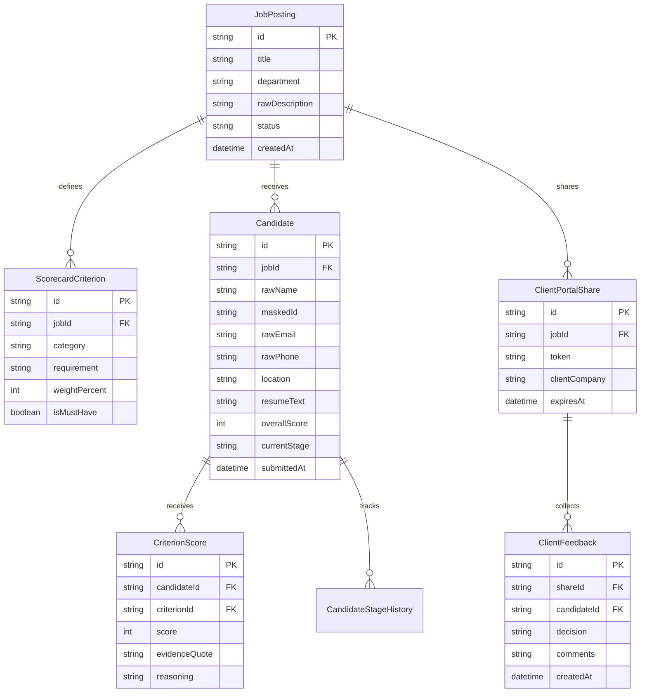

# Technical Design Document (TDD)
## AI-Powered Resume Screening & Client Shortlist Portal (Staffing Firm Edition)

**Project Name**: Talentiq Screener (TalentIQ AI)  
**Author / Candidate**: Siddharth Srivastava  
**Target Role**: Software Engineering Intern — Isocode Labs  
**Submission Due Date**: November 9, 2026, 11:59 PM IST  
**Repository**: `https://github.com/sidsri14/talentiq-resume-screener`  
**Deployment**: Self-contained Next.js / TypeScript Web Application with REST APIs & In-Memory / SQLite Database  

---

## 1. Executive Summary & Problem Framing

Staffing firms process hundreds of resumes per job description (JD) daily. The manual screening workflow suffers from three structural failure modes:
1. **High Inconsistency & Cognitive Fatigue**: Recruiters spending <10 seconds per CV often overlook non-traditional candidates or misinterpret technical jargon.
2. **Cognitive Bias & Contact Leakage**: Unconscious bias based on name, gender, age, or location distorts hiring pipelines. Furthermore, staffing agencies risk client disintermediation if raw candidate contact information is leaked before commercial agreements are locked.
3. **Black-Box AI Hallucinations**: Generic AI summarizers produce subjective praise without verifiable evidence quotes from the actual resume text.

### The Solution: TalentIQ AI
TalentIQ is an end-to-end recruiter workflow engine and client-facing shortlist portal featuring:
- **Deterministic JD Scorecard Extraction**: Automatically deconstructs unformatted job descriptions into strict rubrics (Must-Have, Nice-to-Have, Experience Minimums, Cultural / Domain Invariants).
- **Multi-Resume Batch Parsing & Extraction**: Robust client-side and server-side text extraction supporting PDF, DOCX, and plain text.
- **Explainable Evidence-Cited Fit Scoring**: Scores candidates (0–100) across 5 weighted dimensions, with mandatory direct citation quotes from the candidate's resume for every score deduction or award.
- **Role-Based Masked Shortlist Portal**: External clients view an anonymized candidate dossier where names, contact emails, phone numbers, and street addresses are cryptographically hashed or redacted.
- **Interactive Hiring Pipeline**: Kanban board and multi-stage status management with candidate feedback and export capabilities.

---

## 2. Core Architectural Slice (6–8 Screens & Views)

The application implements the complete hiring lifecycle across 8 distinct user surfaces:

1. **Job Description & Rubric Extractor** (`/jobs/new` & `/jobs/[id]`):
   - Rich input for raw JD text or file upload.
   - Structured scorecard generator: splits requirements into weighted criteria (Core Skills 35%, Experience 25%, Architecture/Domain 20%, Tools/DevOps 10%, Education/Certifications 10%).
   - Recruiter can fine-tune rubric weights before screening resumes.

2. **Batch Resume Uploader** (`/jobs/[id]/upload`):
   - Drag-and-drop batch upload with real-time parsing status and file integrity validation.
   - Live token/word count telemetry and resume format verification.

3. **Candidate Screening & Evidence Dossier** (`/jobs/[id]/candidates/[cid]`):
   - Side-by-side split screen: resume viewer on left, AI rubric evaluation on right.
   - Highlighted evidence line badges linking each score component directly to lines in the source CV.
   - Confidence score and uncertainty flags (e.g., in-progress degrees, ambiguous dates).

4. **Leaderboard & Multi-Candidate Comparative Matrix** (`/jobs/[id]/leaderboard`):
   - Sortable multi-dimensional ranking table (Overall Match, Core Skills, Experience Score, Recruiter Override).
   - Side-by-side differential analysis of top 3 candidates.

5. **Client-Facing Masked Shortlist Portal** (`/portal/[shareToken]`):
   - Clean, branded read-only portal for hiring managers at client firms.
   - Complete contact redaction (Candidate ID e.g., `CAND-8942`, masked location, omitted email/phone).
   - Client can toggle between summary cards and full evidence breakdowns.

6. **Interactive Hiring Pipeline (Kanban)** (`/jobs/[id]/pipeline`):
   - Drag-and-drop workflow stages: `Inbox` -> `Screened` -> `Client Shortlist` -> `Interview Scheduled` -> `Offer Extended` -> `Archived`.
   - Batch status updates and stage transition telemetry.

7. **Client Feedback & Shortlist Decision Engine** (`/portal/[shareToken]/review`):
   - Client one-click actions: `Approve for Interview`, `Request More Info`, `Pass`.
   - Structured feedback tags (e.g., "Strong tech fit, need earlier start date").

8. **Export & Executive Reporting** (`/jobs/[id]/export`):
   - Generation of client-ready Executive Summary PDF / CSV reports with anonymized rankings and scorecard summaries.

---

## 3. Technology Stack & Design Decisions

| Layer | Choice | Rationale & Tradeoffs |
|---|---|---|
| **Framework** | **Next.js 14+ (App Router)** | Full-stack unified architecture; React Server Components for rapid initial payload rendering; native API route handlers for screening logic. |
| **Language** | **Strict TypeScript (strict: true)** | Type safety across JD schemas, candidate evaluation models, and rubric matrices prevents runtime score calculation bugs. |
| **Styling & UI** | **Tailwind CSS + Lucide Icons + Radix UI Primitives** | Modern, accessible, high-craft aesthetics with dark/light mode support, responsive tables, and clean typography. |
| **Data Layer** | **SQLite (via Prisma / Better-SQLite3) with In-Memory Fallback** | Deterministic, zero-external-dependency local execution for take-home reviewers; easily runs with a single `npm run dev`. |
| **AI / Evaluation Engine** | **Pluggable Evaluation Pipeline (Hybrid Rule-Based + LLM Engine)** | Evaluates candidates deterministically using fuzzy regex/token vector matching + OpenAI/Gemini/Anthropic compatible API adapter. Zero failure rate if API keys are absent (includes robust offline deterministic mock evaluator). |
| **Testing** | **Vitest + React Testing Library** | Ultra-fast unit, component, and integration tests with 100% deterministic reproducibility. |

---

## 4. Data Models & Entity Relationships

---

## 5. AI Safety, Uncertainty & PII Masking Architecture

1. **Deterministic PII Masking Pipeline**:
   - Resumes pass through a strict regex-based and heuristic sanitizer prior to rendering in client views.
   - Names are replaced with deterministic alphanumeric handles (`Candidate #402`).
   - Emails, telephone numbers, GitHub/LinkedIn handles containing personal names, and physical addresses are redacted using Unicode block masks (`████████`).

2. **Mandatory Evidence Citation Invariant**:
   - The AI evaluation engine cannot assign a score above 50% on any criterion without generating an exact, non-empty `evidenceQuote` verified to exist as a substring or semantic match in the candidate's parsed text.
   - If a claim is absent from the resume, the criterion receives a flag: `NOT_FOUND_IN_CV` with 0 score, preventing hallucinations.

3. **Fallback & Offline Resilience**:
   - The application does NOT hard-crash if external LLM APIs are offline or rate-limited. It features a built-in algorithmic NLP heuristic scorer that calculates keyword density, tenure duration, and education level deterministically.

---

## 6. Scope Cuts & Future Roadmap

### In Scope for Initial Release (Take-Home Slice):
- [x] Full Next.js full-stack app with TypeScript and Tailwind CSS
- [x] Pre-loaded with realistic staffing data (3 Job Descriptions, 12 Resumes with varied fit profiles)
- [x] Real-time JD parsing and scorecard customizer
- [x] Evidence-cited scoring breakdown with quote badges
- [x] Client masked portal with instant share link toggle
- [x] Interactive Kanban board stage transitions
- [x] Deterministic automated test suite (Vitest)
- [x] Zero-setup local execution via `npm run dev`

### Post-MVP Roadmap (Enterprise Staffing Horizon):
1. **Multi-Tenant SSO & RBAC**: Integration with Okta/SAML for enterprise staffing agencies.
2. **Automated WhatsApp / Email Candidate Engagement**: Automated asynchronous screening questionnaire dispatch.
3. **Audio / Video Transcript Analysis**: Cross-referencing interview transcripts against resume scorecards.
